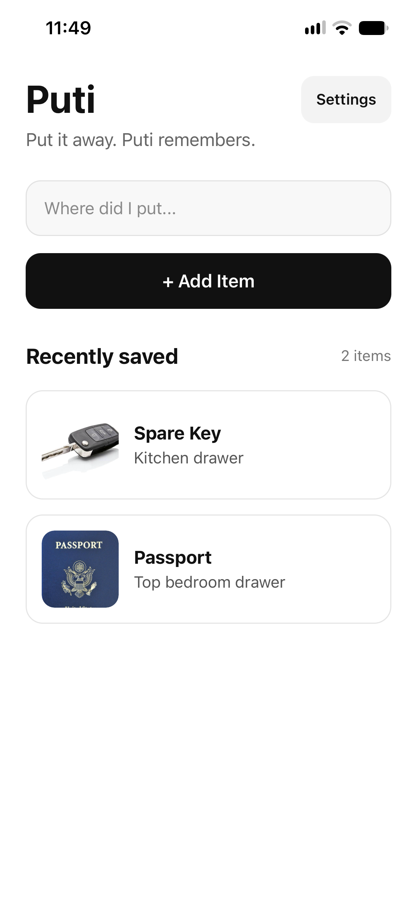
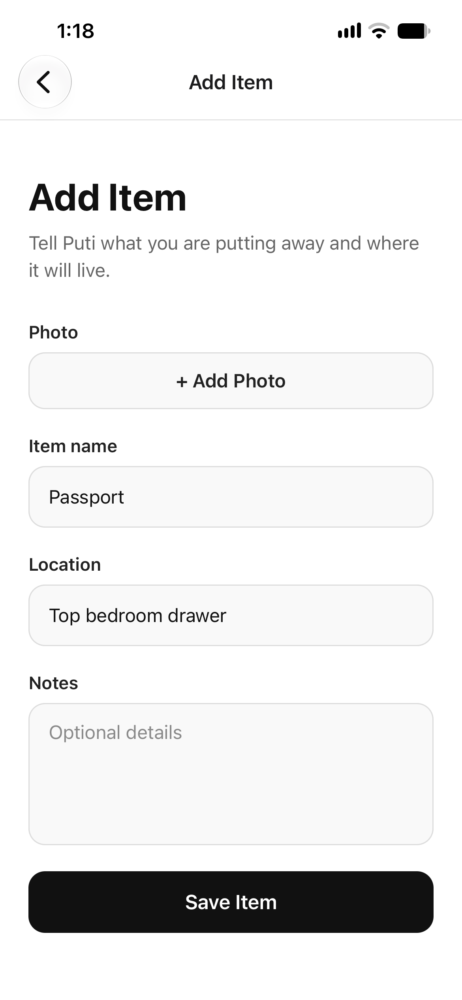
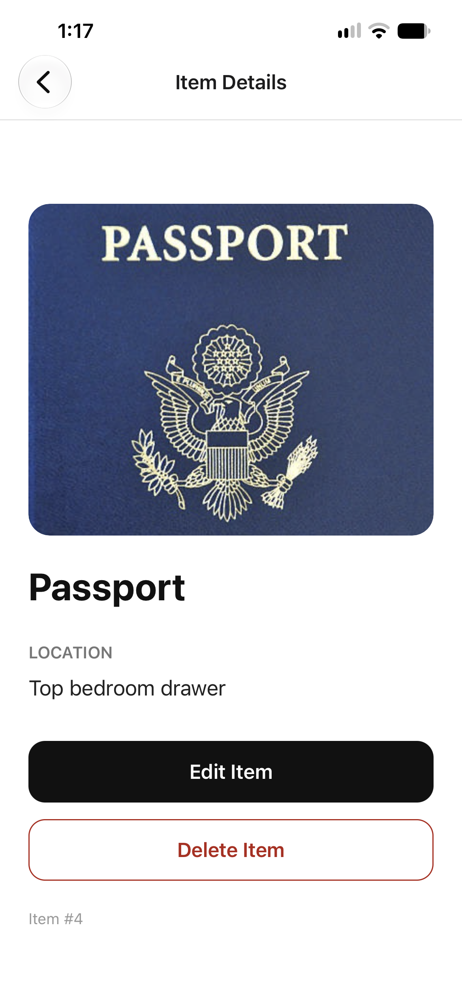

# Puti — Remember Where You Put Things

**Put it away. Puti remembers.**

Puti is a published iOS application designed to help people remember where they store everyday belongings.

Whether it's a passport, spare keys, important documents, or household tools, Puti provides a simple way to record where an item was placed and find that information later.

**[View Puti on the Apple App Store](https://apps.apple.com/us/app/puti/id6809547675)**

## The Problem

It's easy to put something away for safekeeping and forget where it was stored.

Puti addresses this everyday problem by allowing users to create a searchable record of their belongings and storage locations.

## Key Features

- **Save items:** Record an item's name and storage location.
- **Add photos:** Attach an image to help identify an item.
- **Include notes:** Store additional details about where an item was placed.
- **Search belongings:** Find previously saved items using searchable information.
- **Manage records:** View, update, and delete saved items.
- **Simple interface:** Navigate between item creation, search, and item details.

## Technologies and Tools

| Technology | Purpose |
|---|---|
| React Native | Cross-platform mobile application framework |
| Expo | Mobile application development and build workflow |
| TypeScript | Application development |
| Expo Router | Screen navigation and routing |
| Git and GitHub | Version control and project management |
| VS Code | Development environment |
| AI-assisted development | Coding assistance, troubleshooting, and iterative improvements |
| Apple App Store Connect | iOS application submission and distribution |

## Development Approach

I developed Puti as an independent application project, using AI-assisted development alongside hands-on testing, troubleshooting, debugging, and iterative improvements.

The project involved building the user interface, implementing item management and search functionality, working with device capabilities, resolving development issues, and preparing the application for public distribution.

## Application Screenshots

Explore Puti's simple interface for saving and finding everyday belongings.

| Home & Search | Add an Item | Item Details |
|:---:|:---:|:---:|
|  |  |  |

## App Availability

**Platform:** iPhone

**Status:** Published on the Apple App Store

**[Download Puti on the App Store](https://apps.apple.com/us/app/puti/id6809547675)**

## About the Developer

Developed by Alfred Nwankwo, an IT and technical support professional with experience in troubleshooting, application support, technical documentation, and software development.

Puti represents my continued interest in building practical applications and expanding my technical skills through hands-on projects.

## Source Code

This repository is a public portfolio showcase for Puti. The application's production source code is maintained separately and is not included here.
